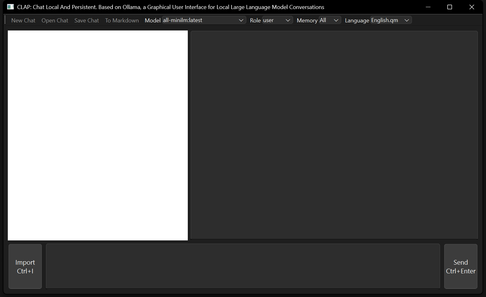
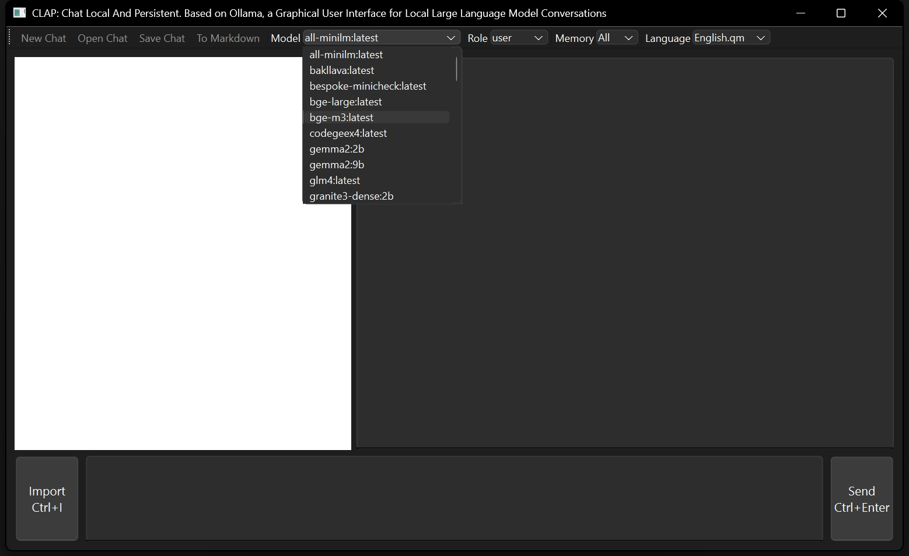
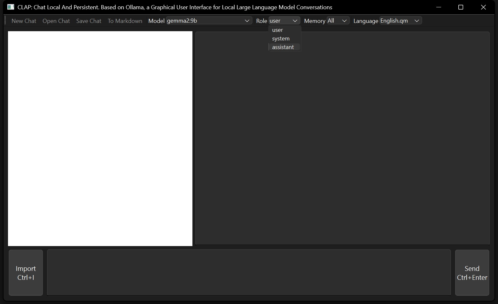
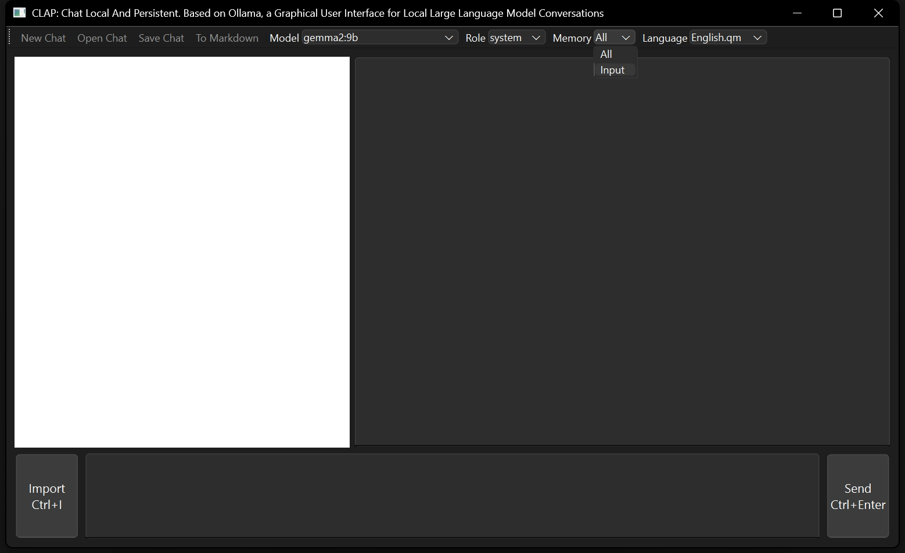
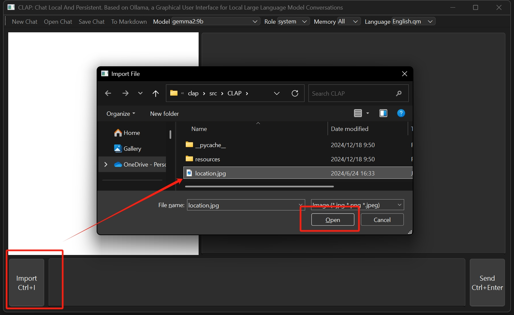
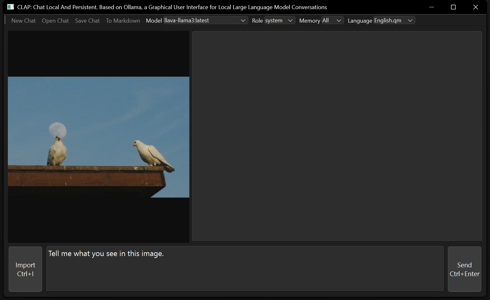
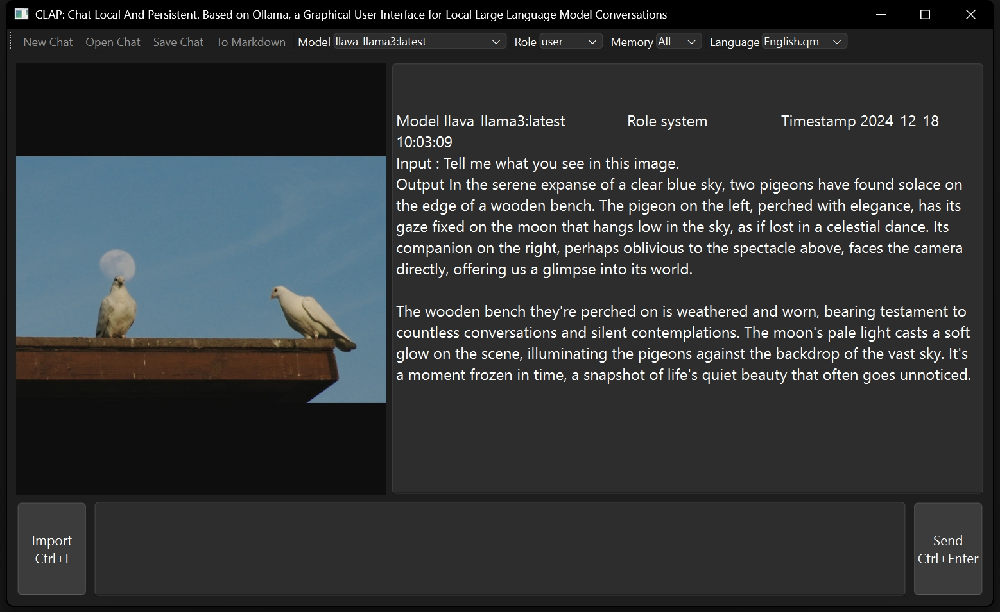
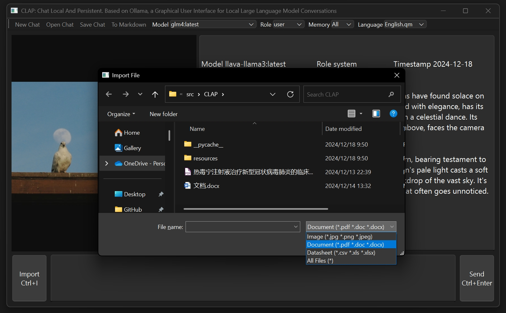
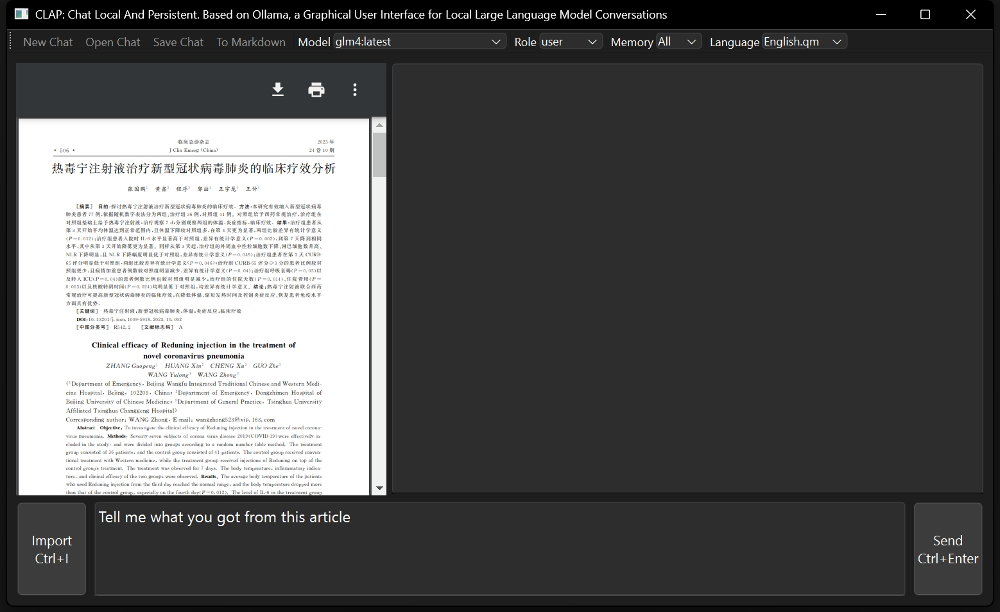
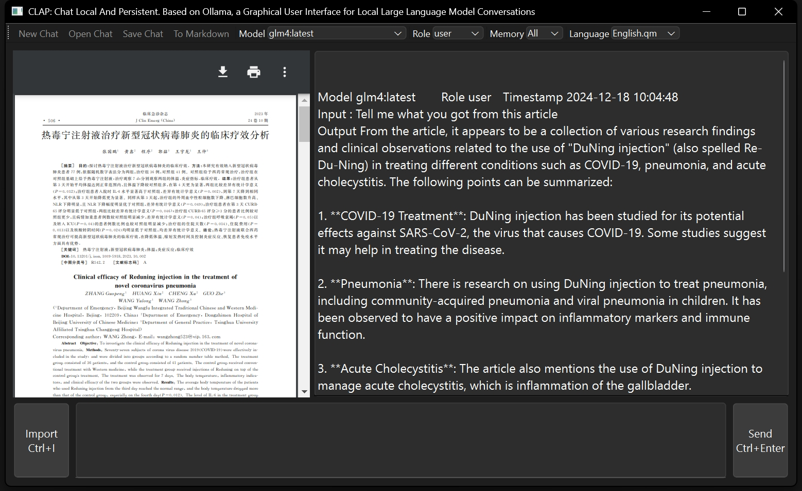

# CLAP: Chat Local And Persistent – Design and Implementation of Contextual Dialogue Loadable under Privacy-Sensitive Network Scenarios with the Ollama Framework’s Local Large Language Model Semantic Interaction Software

**Version:** 1.0.0

## 1. Introduction

In recent years, the internet has permeated every aspect of daily life, and online services, epitomized by large language models (LLMs), have become the darlings of the digital age. However, the use of LLMs in privacy-sensitive contexts poses certain privacy risks and confronts users with the challenge of dialogue continuity.

Regarding privacy, LLMs that rely on network access are susceptible to man-in-the-middle attacks during conversation sessions. Furthermore, user interactions with service providers may lead to the collection of dialogue data, potentially utilized for purposes beyond the original intent.
On another front, without proper archiving of online conversations, resuming previous discussions becomes difficult in privacy-conscious scenarios. Additionally, ensuring the sanitization and deletion of dialogue records is a formidable task.

To address these issues, we present `CLAP`, short for "Chat Local And Persistent." This software is designed for local, persistent dialogues and is built atop the `Ollama` framework, leveraging `Ollama-Python` to interface with locally managed LLMs. `CLAP` facilitates interaction with local LLMs while storing dialogue locally in binary files with a `.clap` extension, enabling users to load these files for dialogue continuation. It also supports exporting dialogue transcripts as Markdown documents.

Featuring a graphical user interface (GUI), `CLAP` enables semantic interaction with local LLMs offline, ensuring privacy and data independence. Developed in Python, it enjoys broad compatibility across platforms, including Windows 10/11 and GNU/Linux.

The development harnesses PySide6 for GUI design and BeeWare for project packaging, ensuring stability and ease of use.

## 2. Environment

Benefitting from the cross-platform capabilities of PySide6 and other foundational libraries, `CLAP` operates seamlessly across various hardware and OS environments. It offers flexible installation options catering to diverse user needs and system configurations, enabling secure, efficient, and platform-agnostic interaction with local LLMs.

To use `CLAP`, users must first download the Ollama framework from its [official website](https://ollama.com/download). Subsequently, they execute a command such as `ollama pull gemma:2b` to download a chosen offline LLM model, which defaults to being stored in `~/.ollama/models/`. Note that while Ollama installation and model downloads require an internet connection, once completed, `CLAP` can operate entirely offline.

### 2.1 Development Environment

The development environment includes:

| Component | Version | Purpose |
|-----------|---------|---------|
| ollama    | 0.1.41  | LLM runtime tool |
| ollama-python | 0.2.0 | Python interface for LLMs |
| Python    | 3.12    | Runtime support |
| PySide6   | 6.6.2   | GUI library |
| beeware   | 0.3.0   | Project framework |
| briefcase | 0.3.16  | Packaging tool |
| matplotlib | 3.8.3 | Plotting library |
| numpy     | 1.26.4  | Numerical computing |
| pandas    | 2.2.1   | Data analysis |
| scipy     | 1.12.0  | Scientific computing |
| toga      | 0.4.2   | Native GUI toolkit |
| toga-chart| 0.2.0   | Chart components for Toga |
| openpyxl  | 3.1.2   | Excel file handling |
| scikit-learn | 1.4.1.post1 | Machine learning library |

### 2.2 Hardware Requirements

Minimum hardware specifications include:

| Component | Requirement |
|-----------|-------------|
| Processor | Dual-core, 64-bit, 1GHz+ (Intel/AMD x86_64, ARM64) |
| GPU       | CUDA12.1 compatible |
| RAM       | 8GB+ |
| Disk Space | 128GB+ |

### 2.3 System Requirements

Supported operating systems:

| OS         | Minimum Version | Architecture |
|------------|-----------------|--------------|
| Windows 10 | 1809            | 64-bit       |
| Windows 11 | 23H2            | 64-bit       |
| Ubuntu     | 22.04.4         | 64-bit       |

## 3. Installation

## 3.1 Install Ollama first

Before installing `CLAP`, ensure that the Ollama framework is correctly installed and configured. Follow the official Ollama installation guide to set up the environment and download the desired LLM model.

Please navigate to the ollama website for detailed instructions: https://ollama.com/download  .
And download the model you want to use after installing Ollama.
For example, you can use the following command to download the gemma model:
```bash
ollama pull gemma:2b
```

## 3.2 Clone and Run from Source

Suitable for all OS users, especially GNU/Linux users, requiring Python 3.10+ and Ollama dependencies.

Clone the repository and install dependencies, then run the application. 
The commands are as follows:
```bash
git clone https://github.com/cycleuser/CLAP.git
cd CLAP
pip insall -r requirements.txt
cd clap
python src\CLAP\app.py
# Or briefcase dev
```

# 4 Interface






















# 5 Web 工作台、ZIM 外置知识库与「有依据」模式

除了桌面 GUI，CLAP 提供一套只监听本机的 Web 工作台（默认 `127.0.0.1:5057`；macOS 的 5000 端口被 AirPlay 占用，故不采用）：

```bash
clap --web              # 打开 http://127.0.0.1:5057
clap --web --port 5057  # 显式指定端口
```

工作台包含四个页面：

- **对话**（`/`）：SSE 流式对话、按 provider 分组的模型下拉、分支切换与任意消息分叉、
  结构化标注、**暂停**（服务端真取消，已出文本保留）、**导出**（Markdown / HTML / JSON，
  点下载后由浏览器选择保存位置）、**分享**（下载 `.clapshare`，不含密钥与本机路径）、**续期**
  （确定性摘要桥接，下一条消息自动携带）。会话本身也可以一键下载为 `.clap`，或从本机选择
  `.clap` 文件加载。
- **知识库**（`/kb`）：ZIM 外置库列表与离线全文检索，点结果直接读原文。
- **时间轴**（`/timeline?file=…`）：渲染指定 `.clap` 会话的时间轴图。
- **接口**（`/api-docs`）：全部端点的契约说明。

## 5.1 ZIM 外置知识库

ZIM（Kiwix 归档）本身就是「带倒排索引的只读知识源」。CLAP **不复制、不入库、不出网**，
直接用 `libzim` 查询归档内建索引：

```bash
export CLAP_ZIM_ROOTS="$HOME/Documents/重点文献"   # 默认值即此目录
```

五类素材已在本机验证：AAAI 2023–2025（33,199 条）、物理讲义（9,342 条）、
世界文学名著（588 条）、诺奖作品（561 条）、相声文本（259 条）。中文「量子」、
英文「transformer」等检索均在 0.1 秒级返回命中。

除 ZIM 外，还可以在「知识库」页添加**纯文本资料**（`.txt` / `.md` / `.markdown` / `.text`）：
可以上传文件，也可以填一个文件或目录路径批量加入。PDF、Word、图片等格式会被拒绝
（无法逐字核对，不能作为依据）。文本资料默认存放在 `~/.clap/text_sources/`
（可用 `CLAP_TEXT_ROOTS` 改路径），检索与 ZIM 一起参与「有依据」模式的取证。
只要至少配置了一个资料源（ZIM 或文本），对话页的有依据模式就会**默认开启**；
手动关掉的选择会被记住。

## 5.2 「有依据」模式：每一步都能回到原文

开启后，每次提问都按同一顺序进行：

1. **先搜资料**：在所有 ZIM 里检索相关内容，长问句会自动去掉标点和疑问词，
   再按关键内容分别检索后合并；
2. **只依据资料回答**：模型只能看检索到的编号材料，说事实的句子要带 `[n]` 引用；
   资料里没有的，就直接回「来源未提及」，不猜也不补常识；
3. **逐句对回原文**：每句都拿去和被引用的那段原文对照，给出「依据度」
   （有据句数 / 可核对的句数）。中文回答、英文原文的情况按术语和人名核对；
   确实没法逐字对照的句子单独计为「跨语言未核对」，不会被判成编造；
4. **能点开核对**：点回答里的 `[1]` 直接展开 ZIM 原文（库名 + 路径），
   导出的文档里同样附来源清单和依据度。

界面支持中文 / English 切换（右上角），选择会记住，也会跟随浏览器语言。目前提供中文、English、日本語、Français、Русский、Deutsch、Español、Português、Italiano、한국어 十种界面语言，以及浅色、深色、跟随系统三种主题；两项选择都会记住。

## 5.3 模型设置：导入 JSON 或手动填写

点顶栏的齿轮打开「模型设置」：

- **导入 JSON**：直接粘贴或选择 opencode / pi / CLAP 风格的配置文件，一键导入服务商、端点、密钥和模型清单。密钥只写入本机配置文件（`~/.config/clap/settings.json`，权限 0600），导入结果与界面上只显示掩码。
- **手动填写**：服务商标识、Base URL、API key、模型名称（逗号分隔）。模型名称留空时才从端点自动获取；端点不提供模型列表时，手填的 ID 会直接用于下拉框。
- **默认模型**：默认使用 `deepseek / deepseek-flash`，也可以在面板里改成任意已配置的模型。
- **测试连接**：逐个服务商检查可用性与模型列表，不会回显密钥。

模型调用全部经由服务商层（OpenAI 兼容 HTTP）：凭证从环境变量
（`*_API_KEY` / `*_TOKEN` / `*_KEY`）、`~/.config/opencode/opencode.json`、
`~/.pi/agent/auth.json` 读入内存，界面与接口只显示掩码，任何响应、日志、导出物
都不包含明文密钥；ollama 默认走 `ollama.com/v1`，本地守护进程需显式
`CLAP_OLLAMA_LOCAL=1`。
